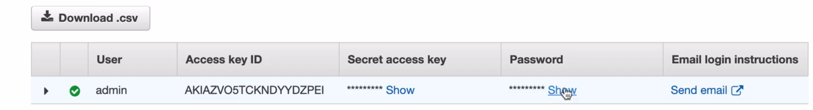

# AWS

## Scope
There is 3 scope in AWS
- Global : IAM, Billing, Route53
- Regions : S3, VPC, DynamoDB
- Availability Zones : EC2, EBS. RDS

When we create a user, it will be available everywehre like any Region or any AZ, so when we switch region it will still show in list
When we create a `S3 bucket` in `ap-south-1` it will not show in `ap-south-2`
When we create a `EC2 instance` for `ap-south-1a`, it will not show in `ap-south-1b`

## Identity and access management (IAM)
When you create an account on AWS, you have a default `root user`, which have `all permissions`
### Best Practice (human users)
- Whenever you get a new AWS account, first create an admin user with less permissions. 
- Admin user should create other users like devops, developer etc with permissions required for them

### system users
- jenkins need permission to deploy code.
- github action need permission to deploye code
- terraform need permission to create a resource.

### Users
We should use users section for create human users or system users. But if possible use role for system users like
| System | Recommended access approach |
| --- | --- |
| Jenkins | IAM role or dedicated machine identity, depending on where Jenkins runs |
| GitHub Actions | IAM role with OpenID Connect (OIDC) federation |
| Terraform | IAM role or other appropriate credentials for the environment running Terraform |

### Group
We can create a group like devops and add users in group, so instead of assign permissions to users, we can creaet a group, assign permissions and asign group to users, so we don't need to update permissions in each user.

### Roles
EC2 intance want access for S3 bucket.
Policies (permissions) can not be assigned to AWS service directly like EC2 access S3 that's why we assign policy to role and then assign role to a service.

we should create role for each service, like we should not create a role with all permissions, if EC2 want to access S3 then create role for EC2 attach policy to access S3 and assign role to EC2

### Create a admin user
- username : set username
- access type (checkbox): 1. AWS management console access (Ui) 2. Programatic (access key and access secret) (aws api, sdk, cli, other tools)  (its checkbox, so it can have both ui and cli)
- console password : it will show when you select ui

When we click on Next it will show three options
- add user to group
- copy permission from existing user
- attach existing policies directly

We will select last (attach existing policies directly) because there should be only one admin, so we will not use group for admin.
Now you can select permissions as per requirement, it can be read only, full access whatever you need as per service. But as we are creating administrator user, so you can select `AdministratorAccess` option which contain all required permissions.
When we click on next it will show a `Tags` optional option which we can use for add some meta data, like user first name, compnay etc.

Click on create user button, it will show success message and details for user with copy access key, access secret etc.


lession 108
Let's create admin user using AWS CLI

#### Step 1: Create the IAM user

bash

```
aws iam create-user --user-name admin-user
```
**Output**
```
{
    "User": {
        "Path": "/",
        "UserName": "admin-user",
        "UserId": "AIDAAVLY5ZL9V9VRCZN3",
        "Arn": "arn:aws:iam::000000000000:user/admin-user",
        "CreateDate": "2026-10-31T07:02:48.911721+00:00"
    }
}
```
#### Step 2: Attach administrator permissions directly

bash

```
aws iam attach-user-policy \
  --user-name admin-user \
  --policy-arn arn:aws:iam::aws:policy/AdministratorAccess
```
#### Step 3: Enable programmatic access

Create an access key:

bash

```
aws iam create-access-key \
  --user-name admin-user
```
**Output**
```
{
    "AccessKey": {
        "UserName": "admin-user",
        "AccessKeyId": "AKIA86GW4ZKF16J8URT8",
        "Status": "Active",
        "SecretAccessKey": "S4N2UrEjuxDgAXlPtdVeg7Qhhjiew+Xi11dey21x",
        "CreateDate": "2026-10-31T07:13:00.136360+00:00"
    }
}
```
Save the returned `AccessKeyId` and `SecretAccessKey` securely. The secret key is only shown when it is created.

Configure the credentials locally:

bash

```
aws configure --profile admin-user
```


Enter the access key, secret key, default Region (for example, `ap-south-1`), and output format (`json`).
```
aws configure --profile admin-user
AWS Access Key ID [****************URT8]: 
AWS Secret Access Key [****************y21x]: 
Default region name [None]: us-east-1
Default output format [None]: json
```
#### Step 4: Enable AWS Console access (UI) (with floci this will return UnsupportedOperation), so with actual AWS we can do this.

Create a file named `create-login-profile.json`:

json

```
{
  "UserName": "admin-user",
  "Password": "ReplaceWithAStrongPassword123!",
  "PasswordResetRequired": true
}
```

Replace the example password with a unique, strong password. Then run:

bash

```
aws iam create-login-profile \
  --cli-input-json file://create-login-profile.json
```

The user can now sign in through the AWS Management Console and will be prompted to change the initial password.


#### Step 5: Verify permissions

Check the user's attached policy:

bash

```
aws iam list-attached-user-policies \
  --user-name admin-user
```
**Output**
```
{
    "AttachedPolicies": [
        {
            "PolicyName": "AdministratorAccess",
            "PolicyArn": "arn:aws:iam::aws:policy/AdministratorAccess"
        }
    ]
}
```
Test the new credentials:

bash

```
aws sts get-caller-identity \
  --profile admin-user
```
**Output**

```
{
    "UserId": "000000000000",
    "Account": "000000000000",
}
```
Without --profile it will be root user

```
aws sts get-caller-identity 
```
**Output**
```
{
    "UserId": "000000000000",
    "Account": "000000000000",
    "Arn": "arn:aws:iam::000000000000:root"
}
```
#### Final result

- IAM user: `admin-user`
- Console access: Enabled with username and password
- Programmatic access: Enabled with access keys
- Permissions: `AdministratorAccess` attached directly to the user
- IAM groups: None created

Security note: Enable MFA and avoid long-lived access keys for routine human administration when temporary credentials are an option.


