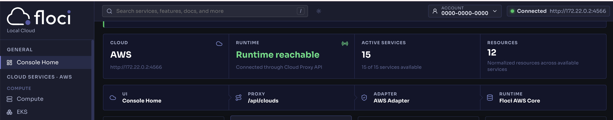

# Floci

Floci is a fast, free, and open-source local AWS service emulator built for developers who need reliable AWS services in development and CI without cost, complexity, or vendor lock-in.

**https://floci.io/floci/getting-started/aws-setup/** 
pull latest docker image or our docker-compose file already have this set, so it will be automatically pull

## Make sure AWS cli installed
```
aws --version
```
If installed, you'll see something similar to:
```
aws-cli/2.32.0 Python/3.13.7 Darwin/24.0.0 exe/arm64
```

## If not installed, install AWS cli in your local computer
```
brew install awscli
```
## Check installation path (macOS)
```
which aws
```

## Check if AWS CLI is working
```
aws sts get-caller-identity
```
This checks whether your CLI can authenticate with AWS (or your configured AWS emulator).
**Output**
```
aws: [ERROR]: An error occurred (InvalidClientTokenId) when calling the GetCallerIdentity operation: The security token included in the request is invalid.
```
As right now we are not authenticate that's why we get above error, to work with aws cli we need to authenticate, floci provide us test credencials which we can use


## Let's configure dummy credentials
Because you're talking to a local Floci endpoint rather than real AWS, you generally don't need real AWS credentials. You can configure dummy values:

```
aws configure
```

Enter, for example:
```
AWS Access Key ID: test
AWS Secret Access Key: test
Default region name: us-east-1
Default output format: json
```

## Setup floci using docker desktop
I have created `docker-compose.yml` which contain all details for start docker container for floci.
```
docker compose up -d
```
Every emulated service is immediately available at http://localhost:4566


Now we have floci running and AWS CLI also configured let's check AWS Cli working or not
```
aws sts get-caller-identity
```
**Output**
```
aws: [ERROR]: An error occurred (InvalidClientTokenId) when calling the GetCallerIdentity operation: The security token included in the request is invalid.
```
**Why this now ?**

It's because when we run any AWS CLI command it will user actual aws endpoint-url, so we need to override it, which we can do by set `--endpoint-url` 

```
aws --endpoint-url http://localhost:4566 sts get-caller-identity
```
**Output**
{
    "UserId": "000000000000",
    "Account": "000000000000",
    "Arn": "arn:aws:iam::000000000000:root"
}

if you don't want to pass `endpoint-url` everytime with AWS CLI command then just run below command in your terminal session and it will available in your terminal session until not close
```
export AWS_ENDPOINT_URL=http://localhost:4566
```

Now you can run command without any url and credencials
```
aws s3 ls
```

Also we can override AWS credential using environment variables as well for current terminal session, for example you want to do something with different AWS account
```
export AWS_ENDPOINT_URL=http://localhost:4566
export AWS_DEFAULT_REGION=us-east-1
export AWS_ACCESS_KEY_ID=test
export AWS_SECRET_ACCESS_KEY=test
```

**Important**
If you set AWS_ENDPOINT_URL, all AWS CLI commands in that terminal will point to Floci, not real AWS.

So:
```
aws s3 ls
```
means:
```
Your computer → Floci (localhost:4566)
```
rather than:
```
Your computer → Amazon S3
```
That's convenient for local development.

## CLI command for copy file from pc to bucket
you can use below command to copy local file into your bucket
```
aws s3 cp test.txt s3://my-bucket/uploads/test.txt

```
now you can open s3 bucket in floci ui using http://localhost:4566 url or you can run below command to see all files uploaded in bucket uploads folder
```
aws s3 ls s3://my-bucket/uploads/
```

---
#### When you upload image from your code and may be your frontend running on different port, so you can get cors error, so just update your port number in cors.json file and run below command for apply cors on your bucket
```
aws s3api put-bucket-cors --bucket my-bucket --cors-configuration file://cors.json
  ```
### Verify
```
aws s3api get-bucket-cors --bucket my-bucket
```
You should see the CORS rule returned.

#### Now this bucket has cors apply and as we are using volume with docker so you don't need to run it again for this bucket

# Use floci with our my pos app for s3 upload
### Change environment variables values
```
MYAPP_S3_AWS_REGION=us-east-1
MYAPP_S3_BUCKET_NAME=my-bucket
MYAPP_S3_BUCKET_URL=http://localhost:4566
AWS_ACCESS_KEY_ID=test
AWS_SECRET_ACCESS_KEY=test
AWS_REGION=us-east-1
```

### make sure to use proper code
right now my app pos code was using below code for upload to s3
```
function getS3Client(): S3Client {
  return (
    _s3Client ??
    (_s3Client = new S3Client({
      region: MYAPP_S3_AWS_REGION,
    }))
  )
}
```
I have changed above code to below
```
function getS3Client(): S3Client {
  return (
    _s3Client ??
    (_s3Client = new S3Client({
      endpoint: MYAPP_S3_BUCKET_URL,
      region: MYAPP_S3_AWS_REGION,
      forcePathStyle: true,
    }))
  )
}
```

### Why forcePathStyle?
Without it, S3-compatible clients may generate a virtual-host-style URL like:

http://my-bucket.localhost:4566/uploads/file.jpg

For local S3-compatible services, path-style is often simpler:

http://localhost:4566/my-bucket/uploads/file.jpg

### set endpoint url in S3Client
As we did not provided url in S3Client it was using actual aws url instead of our local.
So don't assume AWS_ENDPOINT_URL will be used by your application. The safest approach for this code is to explicitly pass the endpoint to S3Client.